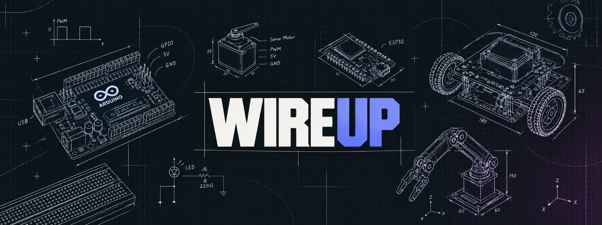

<!-- Hardware engineering profile board: warm paper, ink, signal orange, and scope violet. -->

<table width="100%" bgcolor="#F6F0E6" cellpadding="0" cellspacing="0">
  <tr>
    <td align="center">
        
      
        
      
        
    </td>
  </tr>
</table>

 

<table width="100%" bgcolor="#161616" cellpadding="14" cellspacing="0">
  <tr>
    <td><b>● LAB STATUS: ONLINE</b></td>
    <td align="right"><b>ALDEN / HARDWARE ENGINEERING</b></td>
  </tr>
</table>

 

<table width="100%" cellpadding="20" cellspacing="0">
  <tr>
    <td width="58%" valign="top">
      <b>01 / ENGINEER PROFILE</b>
      <h1>ALDEN NORONHA</h1>
      
<b>Hardware-minded developer · embedded systems builder · product engineer</b>

      
I build practical systems where electronics, firmware, interfaces, and backend services meet. I like turning a rough circuit or idea into something testable, useful, and reliable.

    </td>
    <td width="42%" bgcolor="#AFA2FF" valign="top">
      <b>ACTIVE WORKBENCH / 001</b>
      <h2>systems with character.</h2>
      

      
<b>Microcontrollers Motion + control Full-stack tooling</b>

    </td>
  </tr>
</table>

 

<table width="100%" cellpadding="16" cellspacing="0">
  <tr>
    <td width="33%" align="center" bgcolor="#D9FF62">
      <h2>01</h2>
      <b>DESIGN</b> 
      Understand the system
    </td>
    <td width="33%" align="center" bgcolor="#FF7657">
      <h2>02</h2>
      <b>BUILD</b> 
      Wire it. Code it.
    </td>
    <td width="33%" align="center" bgcolor="#AFA2FF">
      <h2>03</h2>
      <b>VERIFY</b> 
      Measure the result
    </td>
  </tr>
</table>

 

## Engineering focus

<table width="100%" cellpadding="16" cellspacing="0">
  <tr>
    <td width="50%" valign="top" bgcolor="#F6F0E6">
      <b>HARDWARE LAYER</b>
      <h3>Signals, motion, control</h3>
      
Arduino · ESP32 · GPIO · PWM · sensors · servo motors · robotics · prototyping

    </td>
    <td width="50%" valign="top" bgcolor="#F6F0E6">
      <b>SOFTWARE LAYER</b>
      <h3>Interfaces, services, tooling</h3>
      
JavaScript · TypeScript · React · Next.js · Node.js · Express · Python · databases

    </td>
  </tr>
</table>

 

<table width="100%" bgcolor="#FF7657" cellpadding="18" cellspacing="0">
  <tr>
    <td width="35%" valign="middle">
      <b>WORKBENCH LOOP</b> 
      <h2>01 → 02 → 03</h2>
    </td>
    <td width="65%" valign="middle" bgcolor="#F6F0E6">
      <b>OBSERVE</b>&nbsp;&nbsp;→&nbsp;&nbsp;<b>PROTOTYPE</b>&nbsp;&nbsp;→&nbsp;&nbsp;<b>DEBUG</b>
      <h2>Make it useful. Make it measurable.</h2>
      

      
Keep the circuit understandable, the code maintainable, and the result grounded in real behavior.

    </td>
  </tr>
</table>

 

## Toolchain

  

  
  
  

 

<table width="100%" bgcolor="#F6F0E6" cellpadding="18" cellspacing="0">
  <tr>
    <td valign="top">
      <b>02 / TELEMETRY</b>
      <h2>GitHub activity</h2>
      
Experiments, iterations, and shipped systems.

    </td>
    <td align="right" valign="bottom"><h1>↗</h1></td>
  </tr>
</table>

  
  
    
  
    
  
    
  

 

  
    
  

 

<table width="100%" bgcolor="#161616" cellpadding="20" cellspacing="0">
  <tr>
    <td align="center">
      <h2>FROM BENCH TO BUILD.</h2>
      <a href="https://github.com/Aldennoronha2228"><b>INSPECT THE WORK →</b></a>
    </td>
  </tr>
</table>

  
  

